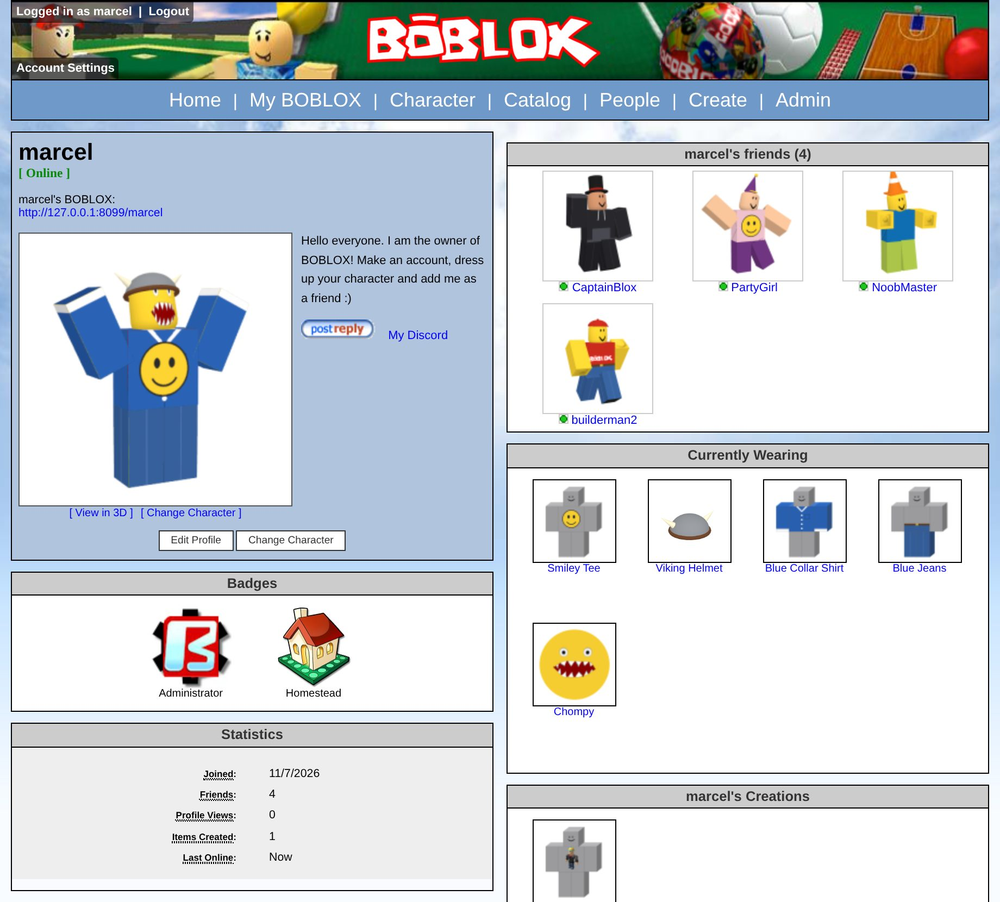
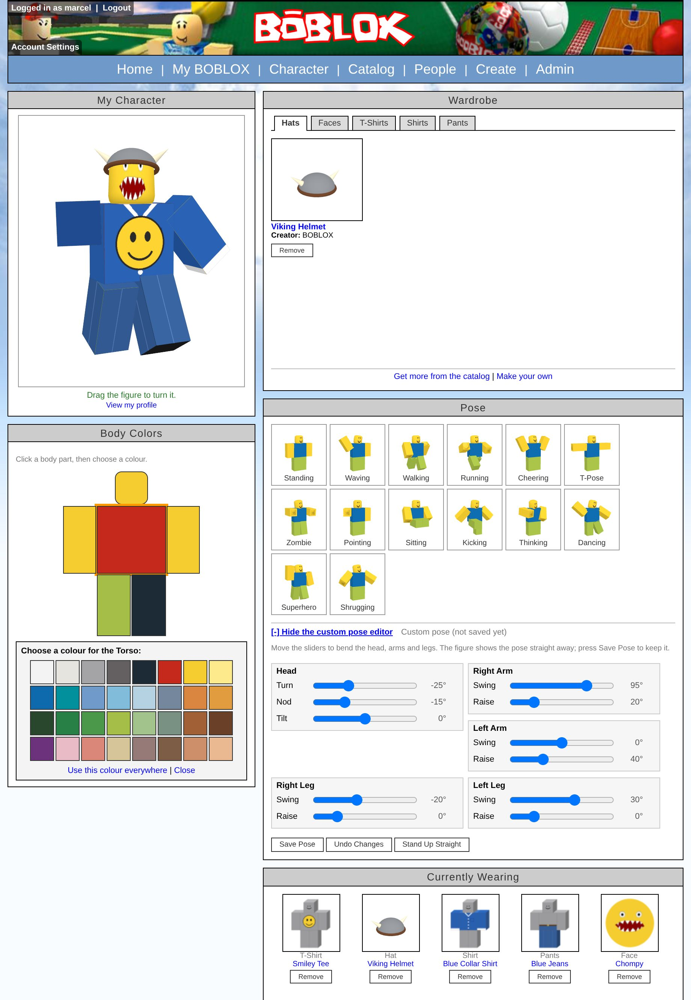
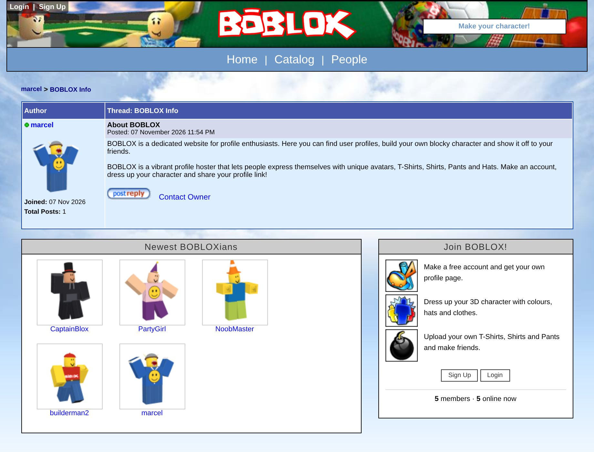
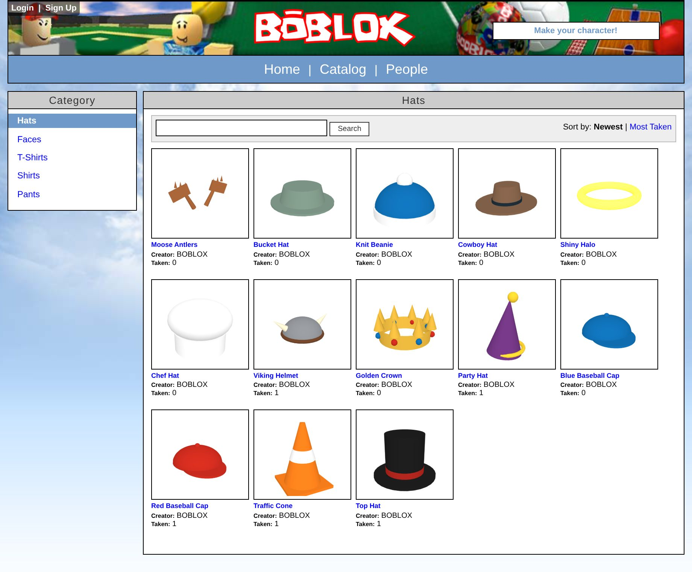
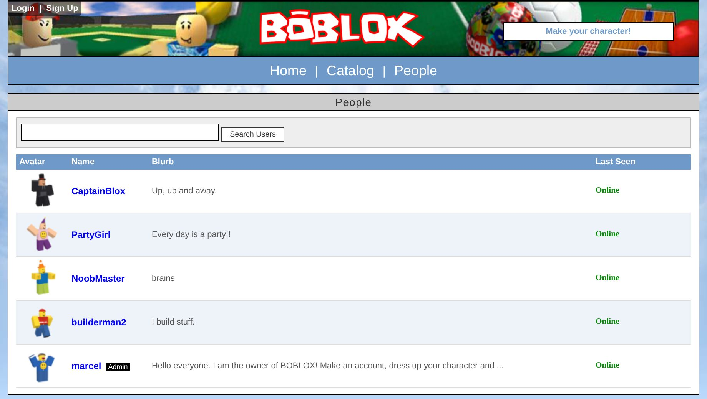
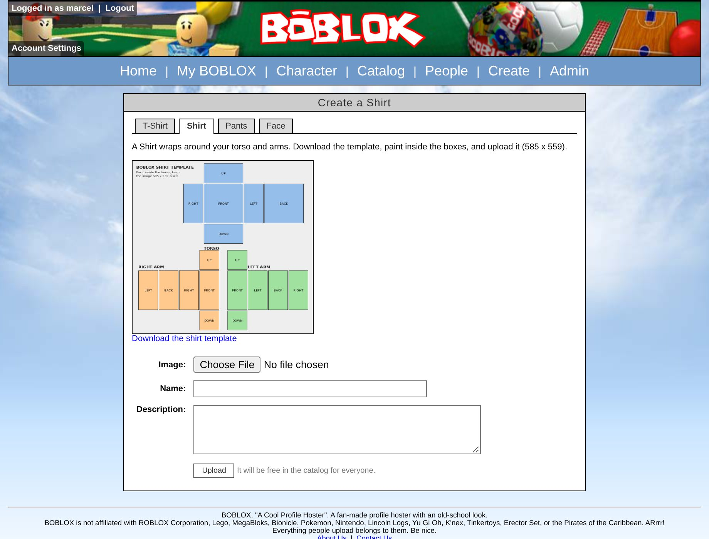
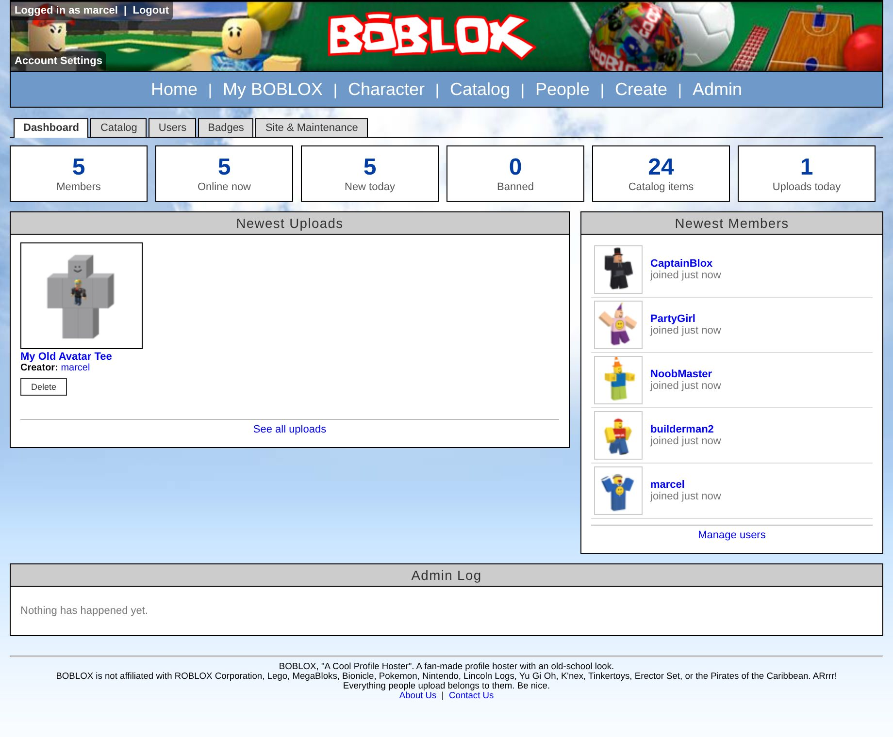
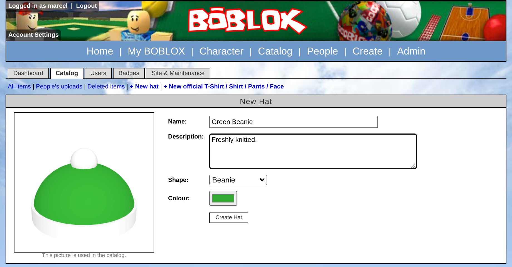
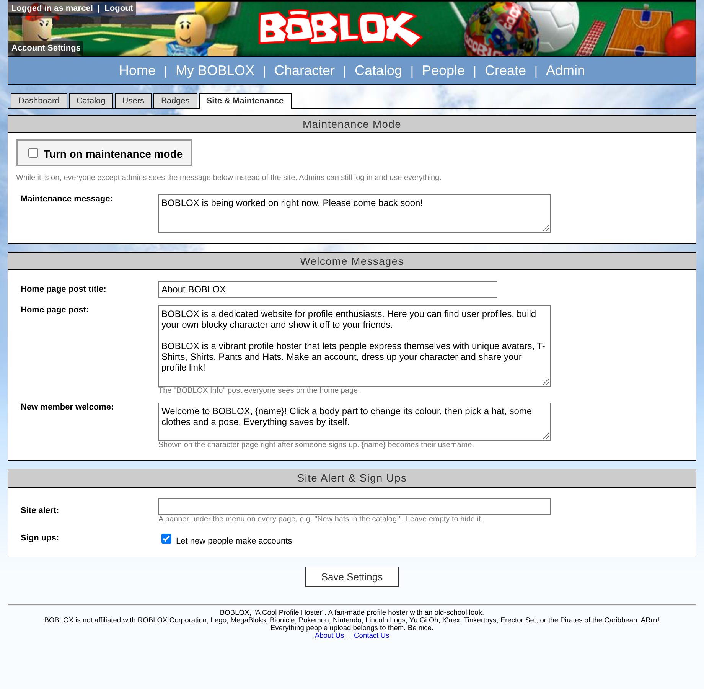

# BOBLOX – a 2006-style profile hoster

BOBLOX is a fan-made profile hoster with an old-school look. People sign up, get their own profile page
(`/yourname`), dress up a blocky 3D character and make friends.

It started as a single static HTML page (`src.zip`, kept for reference). It is now a real website.

## Screenshots

**Profile**: character picture, blurb, badges, statistics, friends and what they're wearing.



**Character page**: recolour body parts, wear hats and clothes, pick a pose or make your own with the sliders.



| Home | Catalog |
| --- | --- |
|  |  |
| **People** | **Create** |
|  |  |

**Admin panel**

| Dashboard | New hat with live 3D preview |
| --- | --- |
|  |  |



## Features

- **Accounts**: sign up, log in and out, change your password. The **first account ever created becomes the administrator**.
- **Profiles** at `/User.aspx?ID=1`, `/users/1/profile` or simply `/marcel`. They show the character picture (with a
  *View in 3D* button), the blurb, a Discord link, badges, statistics (joined, friends, profile views, items
  created, last online), friends, what the person is wearing and what they made.
- **Character page** (`/My/Character.aspx`), using the **2006 figure model** (`tools/figure/2006Figure.fbx`):
  - recolour each body part (head, torso, both arms, both legs) with the 32 colours of the figure's texture,
    or paint everything one colour,
  - wear **Hats**, **Faces**, **T-Shirts**, **Shirts** and **Pants** from your wardrobe,
  - pick one of 14 **poses** (Standing, Waving, Walking, Running, Cheering, T-Pose, Zombie, Pointing,
    Sitting, Kicking, Thinking, Dancing, Superhero, Shrugging) or make a **custom pose** with sliders that turn
    the head and swing or raise each arm and leg,
  - live 3D preview you can turn with the mouse; every change saves by itself over AJAX and
    updates the picture shown on your profile (in your pose).
- **Catalog** (`/Catalog.aspx`): 13 hats, 4 faces and some starter clothes, all free. Search and sort by newest / most taken.
- **Create** (`/My/Create.aspx`): upload your own T-Shirts, Shirts, Pants (585×559 template, downloadable on the page) and Faces.
- **Friends**: send, accept, decline and remove friend requests; alerts in the header.
- **People** (`/Browse.aspx`): find users.
- Creators can delete their own catalog items.
- **Admin panel** (`/Admin/`, shown as "Admin" in the menu for admins):
  - **Dashboard**: member and catalog numbers, newest uploads (with a delete button), newest members and a
    log of everything admins have done.
  - **Catalog**: search every item, edit names and descriptions, delete and restore items, make official
    hats (pick a shape and any colour, with a live 3D preview that also becomes the catalog picture) and upload
    official T-Shirts, Shirts, Pants and Faces.
  - **Users**: search, ban with a reason (banned people are logged out, cannot log in and their profile is
    hidden), unban, make or remove admins, set a new password, delete accounts. The site owner (the first admin)
    cannot be changed by other admins, and admins cannot act on their own account.
  - **Badges**: switch each automatic badge on or off, make custom badges with your own picture, give them to
    people and take them away.
  - **Site & Maintenance**: edit the home page welcome post, the welcome note new members see, a site-wide alert
    banner, open or close sign ups, and turn **maintenance mode** on. During maintenance everyone except admins
    sees your maintenance message (HTTP 503); admins can still log in and use the whole site.

## The 2006 stack

Like the 2006 site, pages use ASP.NET-style addresses (`.aspx` pages, `.ashx` image handlers and `.asmx` web
services), table-and-panel XHTML layouts, the original `AllCSS.css`, and AJAX calls made with a hand-written
`XMLHttpRequest` wrapper that talks JSON to `WebServices/*.asmx/<Method>` and gets ASP.NET AJAX style
`{"d": ...}` answers (`js/Ajax.js`). Character pictures are PNG thumbnails served by `Thumbs/Avatar.ashx`.

Behind those addresses the server code is **PHP with SQLite**, so it runs on ordinary `public_html` hosting
(the original ASP.NET needs Windows/IIS). The 3D preview uses three.js (WebGL), which did not exist in 2006,
because it is the only way to show the real figure model in a browser.

## Running it

Requirements: PHP 7.4 or newer with the `pdo_sqlite` and `gd` extensions.

### On shared hosting (Apache, `public_html`)

1. Upload everything inside `public_html/` to your `public_html` folder.
2. Make sure `public_html/App_Data/` is writable by PHP (the database, uploads and thumbnails go there; `.htaccess`
   keeps it private).
3. Open the site and sign up. Your account is the administrator.

`.htaccess` needs `mod_rewrite` for the `.aspx` addresses and `/username` links. If your host does not have it,
set `FRIENDLY_URLS` to `false` in `App_Code/Config.php` and the site will use plain `.php` addresses instead.

### On your own computer

```sh
php -S localhost:8000 -t public_html public_html/router.php
```

Then open http://localhost:8000/.

## Making it yours

Most things can be changed from the admin panel. The rest is in `public_html/App_Code/Config.php`:

| Setting | What it does |
| --- | --- |
| `SITE_NAME` | Name shown everywhere |
| `SITE_DOMAIN` | Domain shown in profile links (empty = the current host) |
| `BASE_PATH` | `/` or a sub folder such as `/boblox/` (also change `RewriteBase` in `.htaccess`) |
| `OWNER_DISCORD_URL`, `CONTACT_EMAIL` | Owner links on the home page and footer |
| `HOME_POST_TITLE`, `HOME_POST_BODY` | Starting text of the home page post (then edit it in Admin → Site) |
| `REGISTRATION_OPEN` | Whether sign ups start open (then switch it in Admin → Site) |

## Files

```
public_html/
  Default.aspx (.php)      home page ("BOBLOX Info" thread, newest members)
  User.aspx                profiles
  Browse.aspx              people search
  Catalog.aspx, Item.aspx  catalog
  Login/                   login and sign up
  My/                      My BOBLOX, Character, Create, account settings
  Admin/                   admin panel (dashboard, catalog, users, badges, site & maintenance)
  WebServices/*.asmx       AJAX web services (Character, Catalog, Friends, Users, Admin)
  Thumbs/*.ashx            avatar and item pictures
  Asset/                   the figure (2006Figure.json + textures), item textures, starter clothes
  App_Code/                server code (config, settings, database, avatars, poses, badges, admin, layout)
  App_Data/                database, uploads, thumbnails (created at runtime, private)
  js/                      Ajax.js, Site.js, Character.js, Admin.js, Avatar3D.js, Hats.js, BrickColors.js, three.js
  css/                     AllCSS.css (original) + Boblox.css
tools/
  figure/2006Figure.fbx    the figure model
  figure/convert.mjs       turns the FBX into Asset/Figure/2006Figure.json (npm run convert-figure)
  render-hats.cjs          renders the hat pictures in img/Hats
  render-poses.cjs         renders the pose picker pictures in img/Poses
  take-screenshots.cjs     fills an empty site with demo characters and takes the README screenshots
docs/screenshots/          the pictures above
```

### Adding poses

Poses live in `public_html/App_Code/Poses.php` as joint angles in degrees: the head turns, nods and tilts, and
each arm and leg swings forward or back and raises out to the side. Add an entry to `pose_presets()`, then run
`tools/render-poses.cjs` to make its picture for the pose picker.

### Adding hats

To add an existing shape in a new colour, use **Admin → Catalog → New hat**. For a brand new shape, add a
builder to `public_html/js/Hats.js` and its key to `hat_meshes()` in `App_Code/Admin.php`; it then shows up in
the admin panel's shape list.
